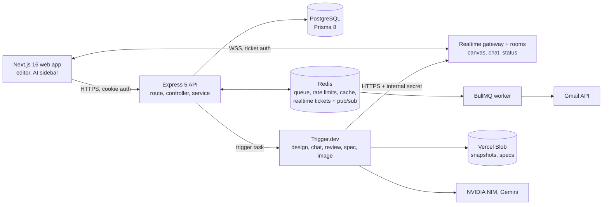
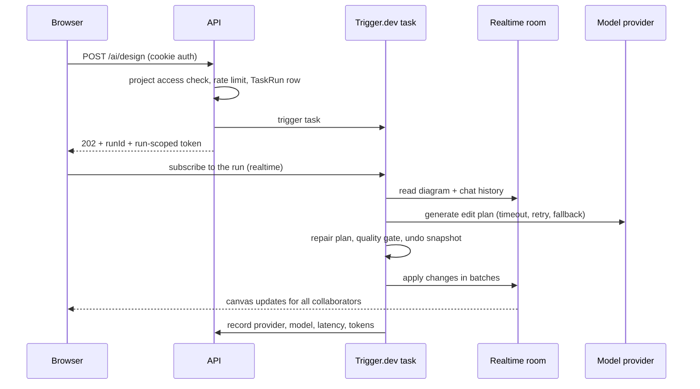
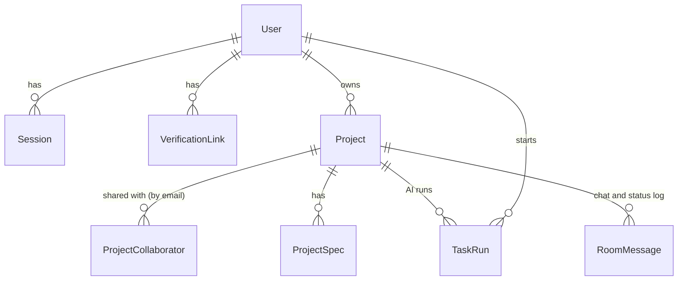
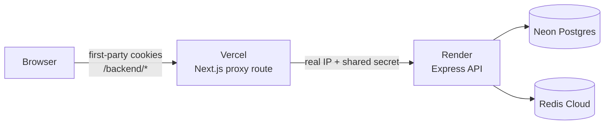
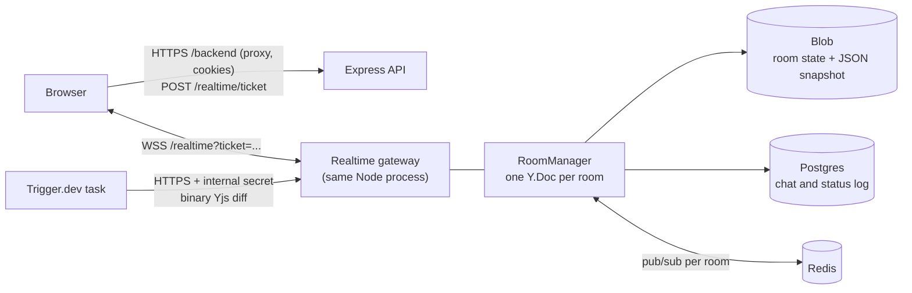

# Plano

[](https://github.com/venkateshg12/plano/actions/workflows/ci.yml)
[](https://github.com/venkateshg12/plano/actions/workflows/deploy-tasks.yml)

**A real-time collaborative system-design workspace where an AI agent draws, reviews and documents your architecture.**

Describe a system in plain English and the AI lays it out on a shared canvas while your teammates watch and edit it live. The same diagram can be questioned in chat, scored by an automated architecture review, rebuilt from a photo of a whiteboard, and turned into a written technical spec.

| | |
|---|---|
| **Problem** | System diagrams are slow to draw, hard to review and quickly go stale next to the written spec. |
| **Solution** | One shared canvas that AI can edit, check and document, with every AI change undoable. |
| **Stack** | Next.js 16, Express 5, PostgreSQL (Prisma 8), Redis, an in-house Yjs realtime engine, Trigger.dev, NVIDIA NIM and Gemini |
| **Shape** | TypeScript monorepo (pnpm + Turborepo): web app, API, and a shared validation package |

## Contents

1. [Features](#features)
2. [System architecture](#system-architecture)
3. [Engineering deep dives](#engineering-deep-dives)
4. [Data model](#data-model)
5. [API overview](#api-overview)
6. [Repository structure](#repository-structure)
7. [Tech stack](#tech-stack)
8. [Getting started](#getting-started)
9. [Testing and CI/CD](#testing-and-cicd)
10. [Deployment](#deployment)
11. [Design decisions](#design-decisions)
12. [In-house realtime engine](#in-house-realtime-engine)
13. [Known limitations and roadmap](#known-limitations-and-roadmap)

## Features

| Feature | What it does |
|---|---|
| **Build** | The AI adds, edits, moves and deletes nodes and edges from a prompt. Layout is computed, not guessed by the model. |
| **Ask** | A chatbot that knows the current diagram and streams its answer into the shared chat for the whole room. |
| **Review** | A 0-100 health score and findings (single points of failure, cycles, shared databases) from graph algorithms, plus AI recommendations that can each be applied with one click. |
| **Sketch to diagram** | Upload a whiteboard photo and a vision model rebuilds it as nodes and edges. |
| **Spec** | Generates a Markdown technical specification from the diagram and stores it with the project. |
| **Undo** | Every AI canvas change is snapshotted first and can be reverted. |
| **Collaboration** | Live cursors, presence, shared editing, owner and collaborator roles. |
| **Starter templates and export** | Microservices, CI/CD and event-driven starters. Export to Mermaid, PNG or JSON. |

## System architecture



### Lifecycle of an AI request

The API never waits on a model. It authorises the request, records a run, hands the work to Trigger.dev and returns immediately. Progress reaches the browser through the realtime room, so every collaborator sees it, not only the person who asked.



### Layering and invariants

The API is strictly layered: **route -> controller -> service**. Controllers validate input with a shared Zod schema, call exactly one service and reply through one response envelope. Services hold the logic and fail fast with `appAssert`. They never touch `req` or `res`. One error handler turns validation, application and unexpected errors into consistent responses.

Rules the codebase enforces:

1. No model call runs inside a request handler. Handlers trigger a task.
2. The AI reads the diagram and chat from the room **on the server**. A client cannot feed it a forged graph.
3. Postgres stores metadata and the chat/status log; blob storage stores large artifacts (the canvas, specs, undo snapshots). For those, Postgres keeps only the reference.
4. Every project read or write goes through an owner or collaborator check.
5. A model's output is a proposal. It is repaired, quality-checked and re-validated before anything touches the canvas.
6. Session revocation goes through one function that also clears the session cache.

## Engineering deep dives

Each section states the problem, what was built and why.

### 1. Reliable AI output from unreliable models

**Problem.** Free-tier model APIs are slow, rate limited and sometimes return valid-looking nonsense. One bad plan must not corrupt a canvas that several people are editing.

**Approach.**
- **Provider chain with fallback.** NVIDIA Nemotron answers first and Gemini is the fallback (a second Gemini model sits behind it). Each attempt has a hard timeout. A 429 or 5xx is retried once, honouring a capped `Retry-After`. A timeout or poor result moves to the next provider. Every attempt (provider, model, latency, reason) is recorded on the run, and the UI shows which model answered.
- **Plan repair.** Operations are re-ordered so nodes exist before the edges that use them and deletions run last. Duplicate ids and edges to missing nodes are dropped. An endpoint named by its label ("Order Service") or polluted with reasoning text is matched back to the right node, so one bad reference costs one edge, not the diagram.
- **Quality gate.** On an empty canvas, a plan with fewer than three components, or fewer connections than 60% of its components, is rejected and the next provider is tried. This catches the case of valid JSON describing 11 boxes and 1 arrow.
- **Layout is code.** The model decides *what* to draw, a dagre layout decides *where*.
- **Batched writes.** The diagram is applied in four groups plus edges instead of one write per node. It grows in stages and stays fast.
- **Fail loudly.** If every provider fails the run fails. Production never falls back to canned output.

**Why this order.** Measured on the same four design prompts (`pnpm --filter server ai:eval` reproduces it against the real providers):

| Provider | Model | Success | Average time | Valid edges |
|---|---|---|---|---|
| NVIDIA | Nemotron 3 Super | 4/4 | 5.0 s | 100% |
| Google | Gemini 3.8 Flash | 4/4 | 16.4 s | 98% |

Nemotron is a reasoning model. With thinking enabled, one run produced valid JSON for 11 nodes and a single edge; with thinking disabled every run connected its nodes. See [ADR 0001](docs/adr/0001-ai-provider-fallback.md).

### 2. Architecture review as algorithms, advised by the model

**Problem.** An LLM asked "is this design good?" gives inconsistent, unverifiable scores.

**Approach.** A pure function in the shared package, running in the browser and on the server, computes:
- single points of failure (articulation points, iterative Tarjan),
- circular dependencies (strongly connected components, Kosaraju),
- islands and unconnected nodes,
- datastores shared by three or more services,
- missing building blocks (cache, queue, gateway, auth, monitoring).

Every point lost from the 0-100 score traces to a finding. The AI review receives these findings as facts, so it adds judgement but cannot contradict the algorithms. The score is deterministic, free and works with no API key. See [ADR 0002](docs/adr/0002-analysis-is-code-the-model-advises.md).

### 3. Undo, cancel and safe "apply fix"

- Before a run changes the canvas, the graph is snapshotted to blob storage and referenced from the `TaskRun` row. Undo restores it, and only for the project's most recent AI change, so it can never clobber later human edits unnoticed.
- Stop calls Trigger.dev's run cancellation and releases the room.
- "Apply fix" reads the recommendation's operations back from the room's stored review, never from the request body. They are re-validated against the current canvas, snapshotted, and applied, so a tampered client cannot inject operations.

### 4. Authentication and session security

| Token | Lifetime | Cookie path |
|---|---|---|
| Access JWT | 15 minutes | `/` |
| Refresh JWT | 30 days | the refresh endpoint only |

Both are `httpOnly`, `Secure` and `SameSite=Strict`. The algorithm is pinned, and each token type has its own audience and secret.

- **Live session check.** Every request confirms the session row still exists (cached in Redis for 60 seconds). A valid signature alone is not enough, so logout, password reset or revoking a device takes effect immediately.
- **Refresh rotation with replay detection.** Each refresh token carries a unique id (`jti`) and rotation is one conditional update, so two concurrent refreshes cannot both win. The previous id is accepted only inside a short grace window; outside it, reuse counts as replay and the session is revoked.
- **Client refresh queue.** The browser collapses concurrent 401s into a single refresh call and replays the queued requests.
- **Passwords.** bcrypt with 12 rounds, and a dummy comparison for unknown emails so response time does not reveal which emails exist. Verification and reset tokens are stored hashed and are single use.
- **Google sign-in.** The ID token is verified on the server before an account is created or linked.
- **Realtime access.** A WebSocket cannot carry the auth cookies across sites, so the browser asks the API (through the proxy, with its cookies) for a single-use 60-second ticket. It is issued only after the membership check, stored hashed in Redis, and consumed atomically on the upgrade. The gateway also checks `Origin`, and every reconnect needs a new ticket, so removing a collaborator takes effect at once: their open sockets are closed and they cannot get another ticket.

### 5. Rate limiting

A custom limiter rather than a library, because the requirements were specific.

- **Algorithm.** A sliding window log in a Redis sorted set, evaluated by one atomic Lua script. It is correct across API instances and has no burst at window edges.
- **Variants.** A plain limit, a *punitive* one (exceeding it sets a lock, used for login and password flows) and a *dual bucket* (per browser and per IP together).
- **Layered login protection.** Login is limited per IP and email, per account and per source IP, so neither one account attacked from many IPs nor many accounts attacked from one IP gets through. The per-account limit is deliberately not punitive, so nobody can lock another user out by typing their email.
- **AI cost control.** AI generation has its own per-user limit, separate from normal API traffic.
- **Trustworthy client IP.** The IP is never taken from a raw header. Trusted proxies are listed explicitly, and behind the web app's proxy a shared secret authenticates the real-IP header.
- **Fail open, safely.** A circuit breaker switches to a bounded in-memory limiter if Redis is down or slow, so Redis trouble never takes the API down. The AI providers have a similar breaker that pauses a failing provider.

### 6. Background work, two systems on purpose

| | Trigger.dev | BullMQ |
|---|---|---|
| **Used for** | AI runs (design, chat, review, spec, image) | Verification and password-reset email |
| **Why** | Long, retried, and watched live from the browser. Managed durable runs with realtime subscriptions. | Small, high-volume, fire-and-forget. A simple Redis queue fits. |
| **Reliability** | Per-task retries and max duration | Exponential backoff, deterministic job ids so a token is never queued twice |

The email worker runs inside the API process and can also run on its own (`pnpm --filter server worker`). It skips malformed payloads, deleted users and already-verified accounts.

### 7. Realtime canvas and storage

- **In-house realtime engine** holds the live canvas (Yjs CRDT), presence, and two server-ordered feeds: `ai-chat` (conversation) and `ai-status-feed` (AI progress). The room id is the project id; see [In-house realtime engine](#in-house-realtime-engine).
- **Private blob storage** holds each room's saved state (`rooms/<id>.ydoc`) and a JSON copy of the canvas that the server writes after every save, plus specs, undo snapshots and uploaded sketches. Content is served only through access-checked API routes. In development without a token, files go to a local `.storage/` folder.
- **Uploads** are validated by their bytes: a type allowlist, a 4 MB cap and a magic-byte check. SVG is rejected. Sketches are deleted when the run ends.

### 8. Shared package

`packages/types` holds the Zod schemas, graph analysis, layout and Mermaid export. Because the browser and the server import the same code, they cannot disagree about a request shape or a health score. Both apps consume the CommonJS build in `dist/` (Turborepo builds it before every build, typecheck and test). After editing `packages/types` while running `pnpm dev`, rebuild it with `pnpm --filter @repo/types build`, or the apps keep using the old build.

## Data model



| Model | Purpose |
|---|---|
| `User`, `Session`, `VerificationLink` | Accounts, refresh-token sessions (current and previous `jti`), hashed email and reset tokens |
| `Project`, `ProjectCollaborator` | Ownership and invitations. Collaborators are invited by email, so an invite works before the person has an account. |
| `ProjectSpec` | Metadata and a reference to the Markdown in blob storage |
| `RoomMessage` | The room's chat and AI-status log (`feed`, JSON `data`), ordered by the server and trimmed to the newest 200 per feed. The canvas is not here; it lives in blob storage. |
| `TaskRun` | One row per AI run: kind, status, provider, model, latency, queue wait, token counts, whether it fell back, and the undo snapshot reference |

Schema changes use Prisma 8's contract workflow: edit `apps/server/src/prisma/contract.prisma`, then `pnpm --filter server db:plan <name>` and `pnpm --filter server db:apply`.

## API overview

All JSON responses use the envelope `{ status, data, meta?, errors? }`. Every `/projects`, `/ai`, `/session` and `/realtime` route requires authentication.

| Area | Endpoints |
|---|---|
| **Auth** | `POST /auth/register`, `/auth/login`, `/auth/google` · `GET /auth/refresh`, `/auth/logout`, `/auth/me` · `GET /auth/verify/:token` · `POST /auth/verify/resend`, `/auth/password/forgot`, `/auth/password/reset/:token` · `PATCH /auth/me` · `POST /auth/me/password` |
| **Sessions** | `GET /session` · `DELETE /session/:id` |
| **Projects** | `GET`/`POST /projects` · `GET`/`PATCH`/`DELETE /projects/:id` |
| **Collaborators** | `GET`/`POST /projects/:id/collaborators` · `DELETE /projects/:id/collaborators/:email` (invite and remove are owner-only) |
| **Canvas** | `GET /projects/:id/canvas` (the JSON copy the room's server saves; the live canvas is edited over the WebSocket) |
| **Specs** | `GET /projects/:id/specs` · `GET /projects/:id/specs/:specId[/download]` |
| **AI** | `POST /ai/design` (Build and Ask), `/ai/spec`, `/ai/design-from-image`, `/ai/review`, `/ai/review/apply` · `POST /ai/runs/:runId/token`, `/cancel`, `/revert` · `GET /ai/usage/:projectId` |
| **Realtime** | `POST /realtime/ticket` (authenticated) · WebSocket upgrade on `/realtime?ticket=…` |
| **Internal** | `/internal/rooms/:id/{state,update,messages,presence}`: Trigger.dev tasks only, bearer `INTERNAL_API_SECRET`, never forwarded by the web proxy |
| **Ops** | `GET /health` |

AI start endpoints return `202` with `{ runId, publicAccessToken }`. The token is scoped to that single run and is re-issued only to the user who started it.

## Repository structure

```
.
├── apps/
│   ├── web/                         Next.js 16 client
│   │   └── src/
│   │       ├── app/                 App Router pages, same-origin API proxy (/backend/[...path])
│   │       ├── components/          editor (canvas, AI sidebar), auth, ui
│   │       ├── api/ + hooks/        the only way the web app reads or writes server data
│   │       ├── store/               Zustand UI state
│   │       └── lib/                 single axios instance with silent token refresh;
│   │                                realtime/ (room client, connection, React bindings, undo)
│   └── server/                      Express 5 API
│       ├── trigger.config.ts        Trigger.dev project and production env sync
│       └── src/
│           ├── routes/              URL + verb + middleware -> controller
│           ├── controllers/         validate (Zod), call one service, reply with ok()
│           ├── services/            business logic, appAssert, access checks
│           ├── middleware/          authenticate, rate limiters, error handler
│           ├── realtime/            WebSocket gateway, rooms, presence, feeds, persistence, Redis bus, tickets
│           ├── trigger/             Trigger.dev tasks: design, chat, review, spec, image
│           ├── jobs/                BullMQ email queue, producers, processors, worker
│           ├── utils/               ai/ (providers, fallback, plan repair), ratelimiter/,
│           │                        storage/, auth/, cache/, realtime.ts (task-side helpers)
│           └── prisma/              contract.prisma and the generated ORM client
├── packages/
│   ├── types/                       Zod schemas, graph analysis, layout, Mermaid export
│   ├── eslint-config/               shared lint rules
│   └── typescript-config/           shared tsconfig bases
├── .github/workflows/
│   ├── ci.yml                       typecheck, lint, test, build on every push and PR
│   └── deploy-tasks.yml             deploys the Trigger.dev tasks on server changes to main
├── docs/                            deployment guide, AI eval notes, architecture decision records
├── context/                         project, architecture and coding-standards notes
└── docker-compose.yml               local Redis (queue and cache) and Postgres
```

## Tech stack

| Area | Technology |
|---|---|
| Language and monorepo | TypeScript, pnpm workspaces, Turborepo |
| Web | Next.js 16, React 19, Tailwind CSS v4, shadcn/ui, TanStack Query, Zustand |
| Canvas and realtime | React Flow, dagre, In-house Yjs CRDT + WebSocket engine |
| API | Node.js 22, Express 5, Zod 4 |
| Database | PostgreSQL, Prisma 8 (contract API) |
| AI | Trigger.dev 4, Vercel AI SDK, NVIDIA NIM (Nemotron 3 Super), Google Gemini |
| Cache, queue, limiter | Redis (`ioredis`), BullMQ |
| Email | Gmail API |
| Storage | Vercel Blob (private) |
| Auth | JWT, bcrypt, Google sign-in |
| Quality | Vitest, ESLint, GitHub Actions |
| Local infrastructure | Docker Compose |

## Getting started

**Prerequisites:** Node.js 20.9+ (22 recommended), pnpm 9, Docker, and a Trigger.dev project. NVIDIA and Gemini keys, a Vercel Blob token, Google OAuth and Gmail credentials are optional locally. Without AI keys, development uses simple offline generators.

```bash
git clone https://github.com/venkateshg12/plano.git && cd plano
pnpm install

docker compose up -d                              # Redis (queue + cache) and Postgres

cp apps/server/.env.example apps/server/.env      # fill in the values below
cp apps/web/.env.example apps/web/.env.local      # NEXT_PUBLIC_API_URL

pnpm --filter server db:plan init                 # first run only: create the tables
pnpm --filter server db:apply

pnpm dev            # web on :3000, API on :5000 (the API also runs the email worker)
pnpm dev:trigger    # second terminal: run the AI tasks locally via the Trigger.dev CLI
```

**Required environment variables** (the commented full lists are in `apps/server/.env.example` and `apps/web/.env.example`):

| Variable | Purpose |
|---|---|
| `DATABASE_URL` | Postgres connection string |
| `JWT_SECRET`, `JWT_REFRESH_SECRET` | Token signing. At least 32 characters each and different from each other (`openssl rand -hex 32`). |
| `CORS_ORIGIN` | Allowed web origin(s), comma-separated |
| `INTERNAL_API_SECRET` | Shared secret (32+ characters) for the Trigger.dev tasks' calls into `/internal/rooms/*`. Tasks also need `INTERNAL_API_URL`, the API's public URL. |
| `TRIGGER_SECRET_KEY` | Trigger AI tasks. Use the `tr_dev_` key locally and the `tr_prod_` key in production. |

**Optional:** `NVIDIA_API_KEY` and `GOOGLE_GENERATIVE_AI_API_KEY` (AI providers), `BLOB_READ_WRITE_TOKEN` (durable storage, required in production), `REDIS_*` and `CACHE_REDIS_*`, `GMAIL_*` (email), `GOOGLE_CLIENT_ID` (Google sign-in), `NEXT_PUBLIC_API_URL` (web), `NEXT_PUBLIC_REALTIME_URL` (web: defaults to `ws://localhost:5000/realtime`; use `wss://<api>/realtime` in production, and put the web origin in the API's `CORS_ORIGIN`, which the socket's `Origin` check uses).

**Email setup:** a one-time browser authorization at `http://localhost:5000/api/auth/gmail` prints `GMAIL_REFRESH_TOKEN` in the API console. Paste it into `.env` and restart.

## Testing and CI/CD

```bash
pnpm test                      # all workspaces (229 tests)
pnpm --filter server realtime:load   # realtime load and convergence test (about 5 minutes)
pnpm typecheck && pnpm lint
pnpm --filter server ai:eval   # compare AI providers on benchmark prompts (calls real APIs)
```

The tests target the parts that are easy to get subtly wrong: the provider fallback runner (timeouts, retries, ordering), plan repair and the quality gate, plan batching, graph analysis (articulation points, cycles, scoring), layout, Mermaid export, the rate-limiter and client-IP trust rules, and the proxy helpers. The realtime engine has the most coverage: CRDT convergence under random, duplicated and reordered updates, the protocol over real sockets (including joining a room that is still loading), persistence and restart, feed identity stamping, per-user undo, and two API instances sharing rooms through an in-memory bus.

| Pipeline | Trigger | What it does |
|---|---|---|
| **CI** (`ci.yml`) | Push to `main`, every pull request | Install, typecheck, lint, test and build. A newer push cancels the older run. |
| **Deploy AI tasks** (`deploy-tasks.yml`) | Push to `main` touching `apps/server`, `packages/types` or the lockfile | Builds the shared package and runs `trigger deploy`. Environment variables come from the GitHub `production` environment's secrets and are synced to Trigger.dev by `trigger.config.ts`. |

## Deployment

The target is free tiers: **web on Vercel, API on Render, Postgres on Neon, Redis on Redis Cloud, AI tasks on Trigger.dev**. The full step-by-step guide is in [docs/deployment.md](docs/deployment.md).

The one non-obvious part is cookies. `*.vercel.app` and `*.onrender.com` are different sites, so a browser calling the API directly would treat the login cookies as third-party. `SameSite=Lax` is not sent on cross-site requests and `SameSite=None` is blocked by Brave, Safari and Firefox. So the browser talks only to the web app, and a Next.js route handler forwards `/backend/*` to the API ([ADR 0003](docs/adr/0003-same-origin-api-proxy.md)):



- The WebSocket does not go through the proxy (a Next.js route handler cannot proxy an upgrade). The browser connects to the API directly at `NEXT_PUBLIC_REALTIME_URL`, authenticated by a ticket it fetched through the proxy, and the API checks the request's `Origin` against `CORS_ORIGIN`.
- The proxy forwards only an allowlist of headers, never follows redirects, and times out at 55 s (Vercel Hobby allows 60 s).
- The visitor's IP travels in a header the API trusts only when `PROXY_SHARED_SECRET` matches, so rate limits stay per visitor.
- Render's free tier sleeps when idle. The app treats 502/503/504 as "server waking up" and keeps the loading screen up, retrying for about two minutes instead of showing a signed-out page.
- In production the API refuses to boot without durable storage, never returns canned AI output, and keeps the queue dashboard and IP debug endpoint off by default.
- Set `TRIGGER_SECRET_KEY` on the API to the **production** (`tr_prod_`) key. A `tr_dev_` key sends tasks to the Dev environment, which only runs while `trigger dev` is open on a laptop.

## Design decisions

| Decision | Why |
|---|---|
| Trigger.dev for AI, BullMQ for email | AI runs are long, retried and watched live, which Trigger.dev provides as managed durable runs. Email is small and high-volume and fits a plain queue. |
| NVIDIA first, Gemini second | Measured: 5.0 s versus 16.4 s on average, both reliable once validated. |
| Review is algorithms plus a model | The model cannot contradict the algorithms, the score is deterministic and free, and it works without an API key. |
| Server reads the room, not the client | A client cannot feed the AI a forged graph or chat history. |
| Repair plans before applying | The canvas is shared state. One wrong id from a model should cost one dropped edge, not a broken diagram. |
| Batched canvas writes | One write per node was slow and chatty. Four groups plus edges are faster and nicer to watch. |
| Same-origin proxy | Keeps strict cookies working on free hosting in every browser. |
| Custom Lua rate limiter with a circuit breaker | Atomic and correct across instances, and Redis trouble never takes the API down. |
| Shared validation and graph code | The browser and server cannot disagree about a request shape or a health score. |
| Postgres holds references, blob holds content | Keeps rows small and lets large artifacts move storage backends without a schema change. |

Architecture decision records: [docs/adr/](docs/adr/).

## In-house realtime engine

> Architecture and design specification: [docs/realtime-engine/](docs/realtime-engine/README.md) · decision record: [ADR 0004](docs/adr/0004-own-realtime-engine.md) · failure drills: [docs/realtime-engine/failure-drills.md](docs/realtime-engine/failure-drills.md).

The in-house engine powers five core capabilities: the collaborative canvas (CRDT), presence and smooth cursors,
server-ordered Postgres feeds (`ai-chat` and `ai-status-feed`), server-side AI canvas writes, and per-user undo.
[Yjs](https://github.com/yjs/yjs) supplies the CRDT merge algorithm. The binary WebSocket transport, rate-limited
gateway, single-use ticket auth, 50 ms coalesced presence, durable blob persistence, Redis horizontal pub/sub,
and internal task APIs are completely in-house.



| Problem | Solved implementation |
|---|---|
| Concurrent edits to one diagram | One Yjs document per room. Nodes are nested maps, so concurrent moves, label edits, and additions merge conflict-free. |
| Authenticating a WebSocket across sites | Single-use 60s ticket generated via `/realtime/ticket` (stored in Redis with SHA-256 hash), consumed atomically on WebSocket upgrade. A request with a missing or unlisted `Origin` is refused, which blocks cross-site hijacking. |
| Cheap reconnects and offline edits | State-vector binary handshake (`SYNC_STEP1`, `SYNC_STEP2`, `UPDATE`). Clients send only missing updates upon reconnecting. |
| Cursor traffic scalability | Throttled client-side, batched per room on the server every 50 ms, and slow/lagging sockets drop presence frames first. |
| Chat order and trusted author | Feeds are a Postgres log (`RoomMessage`), not part of the CRDT. Server stamps the author from the authenticated session ticket. |
| AI edits racing with humans | Tasks edit via `MutableFlow` using the same plan applier interface, posting binary diffs over internal secret-authenticated HTTP that merge cleanly with concurrent human edits. |
| Undo in a shared document | `FlowUndoManager` scoped exclusively to the local client's origin, preserving teammates' and AI modifications. |
| Durability and graceful shutdown | The server saves each room: full compacted state to blob storage after 2 s idle (10 s at most while editing), plus a JSON copy. Saves queue, retry on failure and are flushed when the last person leaves and on `SIGTERM`. A failed read of room state fails the join rather than loading older data. |
| Horizontal scale-out | Updates fan out across instances via Redis pub/sub (`rt:room:${roomId}`). A Redis lock lets one instance write a room's blob at a time. A room opened on a second instance asks its peers for presence and unsaved state, because pub/sub keeps nothing; after a Redis outage every room republishes its state. |
| Malformed or abusive clients | A CRDT cannot refuse an operation once merged, so the gateway checks what each update touched, deletes anything malformed and closes the socket (`4413`). Frame size, update, presence, feed and save rates are limited per connection, and a user can hold 10 sockets per room. |

### Tests and measurements

- **Property test (`property.test.ts`):** 5 simulated replicas receive random edits out of order and with duplicates and all end identical.
- **Protocol tests over real sockets (`gateway.test.ts`, `scale.test.ts`):** origin and ticket checks, joining a room that is still loading, offline edits merging, malformed-entry quarantine, frame and rate limits, two API instances converging, kicks, project deletion and a Redis outage.
- **Failure behaviour:** what is covered by tests and what still needs a manual run is in [docs/realtime-engine/failure-drills.md](docs/realtime-engine/failure-drills.md).
- **Load test** (`pnpm --filter server realtime:load`, 60 s per size, every client making 10 random edits per second: add, move, relabel, connect, delete). Latency is end to end: the sender stamps the time inside a node's data and each other client reads it back when the update arrives. At the end every client and the server must hold identical documents. Measured on one machine; the server and all simulated clients share one Node process, so CPU and memory overstate the server alone and the 50-client row is limited by the test harness as much as by the engine.

| Clients | Converged | p50 | p95 | p99 | Frames/s received | CPU (one core) | RSS |
|---|---|---|---|---|---|---|---|
| 2 | yes | 1 ms | 3 ms | 4 ms | 18 | 6% | 160 MB |
| 5 | yes | 1 ms | 3 ms | 4 ms | 179 | 10% | 191 MB |
| 20 | yes | 3 ms | 24 ms | 55 ms | 3,326 | 69% | 593 MB |
| 50 | yes | 86 ms | 174 ms | 298 ms | 15,388 | 115% | 1,398 MB |

Persistence and feeds are in memory during the load test, so it never touches blob storage or Postgres. Numbers from a different machine or a networked deployment will differ.

## Known limitations and roadmap

**Limitations**
- Free-tier hosting means cold starts on the API and tight limits on the AI providers.
- Undo covers only the most recent AI change per project.
- Specs have no version history or review workflow.
- A room holds at most 500 nodes and 1,000 edges.
- Render's free tier runs one API instance, so multi-instance scale-out is proven by tests and a local run, not deployed.
- The browser-level failure drills (API restart with open tabs, two instances on a real Redis, throttled network) are written down but have not been run by hand yet; see [failure-drills.md](docs/realtime-engine/failure-drills.md).
- Chat history from before the move to the in-house engine was not migrated.

**Roadmap**
- [x] In-house realtime engine replacing Liveblocks.
- Per-project AI budgets and a response cache for repeated prompts.
- Version history for the canvas (AI-run snapshots already exist).
- End-to-end browser tests in CI.
- Bundle the API for lower memory use and faster cold starts.

## Author

Venkatesh · [github.com/venkateshg12](https://github.com/venkateshg12)
