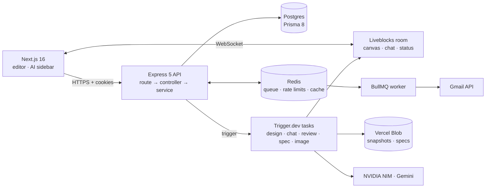
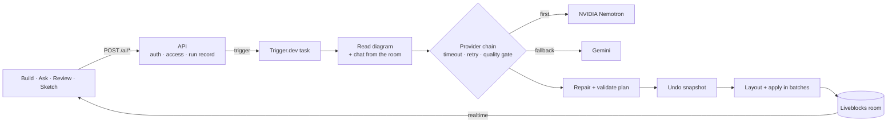
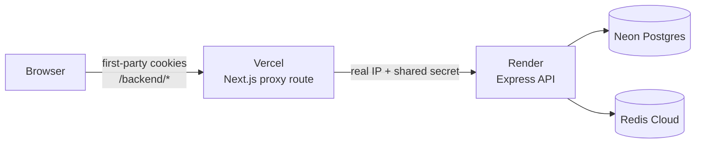

# Ghost AI

**Describe a system in plain English and watch an AI draw it on a shared canvas, live, together with your team.**

Ghost AI is a real-time collaborative system-design workspace. An AI agent turns a prompt into a diagram, collaborators refine it together, a chatbot answers questions about it, an automated review scores its architecture, and one click turns the diagram into a written technical spec.

It is a TypeScript monorepo (pnpm + Turborepo): a Next.js 16 app, an Express 5 API on Postgres, AI work on Trigger.dev, and a shared package that both sides validate against.

## ✨ What makes it interesting

- **The AI edits a live, shared canvas.** Every collaborator sees the diagram appear in stages while the AI's cursor moves across the board.
- **It never trusts one model.** NVIDIA Nemotron answers first, Gemini is the fallback. Slow or useless answers fall through automatically, and the UI shows which model replied.
- **A model's plan is a suggestion, not a command.** Plans are repaired and quality-checked before touching the canvas. A valid-looking plan with 11 boxes and 1 arrow is rejected, not drawn.
- **Every AI change can be undone** from a snapshot taken before the run.
- **Architecture review in plain code.** Graph algorithms find single points of failure, cycles and shared databases, and produce a 0–100 health score in the browser with no API key. The AI adds recommendations on top, and each can be applied with one click.
- **Ask mode:** a chatbot that knows your diagram and streams its answer into the shared chat for the whole room.
- **Sketch to diagram:** upload a whiteboard photo and a vision model rebuilds it as nodes and edges.
- **Production-grade backend:** rotating refresh tokens, a Redis rate limiter written in Lua with a circuit breaker, background email workers, and a deployment that keeps `SameSite=Strict` cookies working on free hosting.

## 🏗️ Architecture



The backend is strictly layered: **route → controller → service**.

- **Controllers** validate input with a Zod schema, call one service and reply through one response envelope.
- **Services** hold the logic and fail fast with `appAssert(...)`. They never touch `req` or `res`.
- **One error handler** turns validation, application and unexpected errors into consistent responses.

**Rules the system keeps:**

- No model call ever runs inside a request handler. The API checks access, records a run and triggers a Trigger.dev task.
- The AI reads the diagram and chat history from the room **on the server**, so a client can't feed it a forged graph.
- Large content (canvas snapshots, specs, undo snapshots) lives in blob storage. Postgres keeps only the reference.
- Every project read or write goes through an owner/collaborator access check.

## 🤖 How the AI works



| Feature | What it does |
|---|---|
| **Build** | The AI adds, edits, moves and deletes nodes and edges; boxes are laid out automatically. |
| **Ask** | Answers questions about the diagram without changing it, streaming into the shared chat. |
| **Review** | Instant health score and findings from graph algorithms, plus AI recommendations you can apply one by one. |
| **Undo** | Reverts any AI change to the exact state before it. |
| **Sketch** | Rebuilds a photographed whiteboard as a diagram. |
| **Spec** | Writes a Markdown technical specification from the diagram. |
| **Tidy / Export** | Auto-layout, and export to Mermaid, PNG or JSON. |

### Provider chain

Each attempt gets a hard time limit and a quality check. A 429 or 5xx is retried once, a timeout or poor result moves to the next provider, and every attempt (provider, model, latency, reason) is recorded on the run. If everything fails, the run fails loudly. Production never falls back to canned output.

The order comes from measurements, not guesses. On the same four design prompts:

| Provider | Model | Success | Average time | Valid edges |
|---|---|---|---|---|
| NVIDIA | Nemotron 3 Super | 4/4 | **5.0 s** | 100% |
| Google | Gemini 3.8 Flash | 4/4 | 16.4 s | 98% |

(`pnpm --filter server ai:eval` reproduces this table against the real providers.) Nemotron is a reasoning model: with thinking on, one run produced valid JSON describing 11 nodes and a single edge. With thinking turned off every run connected its nodes, and the quality gate backs that up.

### Plan repair and the quality gate

- **Repair:** operations run in a safe order (nodes before the edges that use them, deletions last). Duplicate ids and edges to missing nodes are dropped. An endpoint named by its label ("Order Service") or polluted with reasoning text is matched back to the right node instead of losing the edge.
- **Gate:** on an empty canvas, a plan with fewer than 3 components, or fewer connections than 60% of its components, is rejected and the next provider is tried.
- **Batched writes:** the diagram is applied in four groups plus edges instead of one write per node, so it grows in stages and stays fast.

### Architecture analyzer

A pure function in the shared package, running in the browser and on the server:

- single points of failure (articulation points by iterative Tarjan),
- circular dependencies (Kosaraju strongly connected components),
- islands and unconnected nodes,
- datastores shared by three or more services,
- missing building blocks (cache, queue, gateway, auth, monitoring).

Every point lost from the 0–100 score traces to a finding. The AI review receives these findings as facts, so it can add judgement but cannot contradict the algorithms.

## 🔐 Authentication

| Token | Lifetime | Cookie path |
|---|---|---|
| Access JWT | 15 min | `/` |
| Refresh JWT | 30 days | the refresh endpoint only |

Both are `httpOnly`, `Secure` and `SameSite=Strict`. The algorithm is pinned, and each token type has its own audience and secret.

- **Live session check:** every request confirms the session row still exists (cached in Redis for 60 s). A valid signature alone is not enough, so logout, password reset or revoking a device takes effect immediately.
- **Refresh rotation:** each refresh token carries a unique id and rotation is a single conditional update, so two concurrent refreshes can't both win. A stale token is accepted only inside a short grace window; otherwise it counts as replay and the session is revoked.
- **Client queue:** the browser collapses concurrent 401s into one refresh call and replays the queued requests.
- **Passwords:** bcrypt (12 rounds) with a dummy compare for unknown emails so timing doesn't reveal which exist. Verification and reset tokens are stored hashed and used once.
- **Google sign-in:** the ID token is verified server-side before an account is created or linked.
- **Project access:** owner or collaborator, checked in every service call. Realtime room tokens are issued only after that check.

## 🚦 Rate limiting

A custom limiter, not a library.

- **Algorithm:** a sliding window log in a Redis sorted set, evaluated by one atomic Lua script. It is correct across API instances and has no burst at window edges.
- **Variants:** a plain limit, a *punitive* one (exceeding it sets a lock, used for login and password flows) and a *dual bucket* (per browser and per IP together).
- **Login is limited three ways** so neither one account attacked from many IPs nor many accounts attacked from one IP slips through. The per-account limit is deliberately not punitive, so nobody can lock another user out by typing their email.
- **Per user:** 300 API calls per 5 minutes, and AI generation 6 per minute.
- **Client IP is never taken from a raw header.** Trusted proxies are listed explicitly, and behind the web app's proxy a shared secret authenticates the real-IP header.
- **Failure mode:** a circuit breaker switches to a bounded in-memory limiter if Redis is down or slow, so Redis trouble never takes the API down.

## 🧵 Background jobs

Verification and password-reset emails are sent outside the request. The API enqueues a BullMQ job and replies; a worker sends it through the Gmail API with exponential backoff. Producers use deterministic job ids so a token is never queued twice, and the worker skips malformed payloads, deleted users and already-verified accounts. The worker runs inside the API process and can also run on its own.

## 🗄️ Data and storage

PostgreSQL through Prisma 8's contract API.

| Model | Purpose |
|---|---|
| `User`, `Session`, `VerificationLink` | accounts, refresh-token sessions, hashed email and reset tokens |
| `Project`, `ProjectCollaborator` | ownership and invitations (room id = project id) |
| `ProjectSpec` | reference to a generated spec |
| `TaskRun` | one row per AI run: kind, status, provider, model, latency, tokens, whether it fell back, snapshot reference |

Private blob storage holds the autosaved canvas snapshots, generated specs, undo snapshots and uploaded sketches. Locally, files go to a `.storage/` folder instead.

## 🖥️ Web app

- **Next.js 16 App Router** with `AuthLoader` resolving the session first, so the wrong screen never flashes.
- **TanStack Query** (one hook per operation) for server data, **Zustand** for UI state, and one axios instance with silent refresh.
- **Canvas:** React Flow with Liveblocks sync, six shapes, a colour toolbar, starter templates (microservices, CI/CD, event-driven), live cursors and presence.
- **AI sidebar:** chat with Build/Ask modes, slash commands, sketch upload and a Stop button; a Review tab with a health ring, findings and usage stats; a Specs tab. Replies stream as Markdown with a badge showing which model answered.
- **Landing page** for signed-out visitors.

## 🛡️ Security highlights

| Area | What's done |
|---|---|
| Cookies and tokens | httpOnly, `Secure`, `SameSite=Strict`, pinned algorithm, separate audience and secret per token type |
| Sessions | server-side revocation, rotation with replay detection |
| Input | Zod validation on every body and param |
| Access | owner/collaborator check in every service call; AI run tokens scoped to one run |
| Uploads | type allowlist, 4 MB cap, magic-byte check, SVG rejected |
| Rate limiting | per IP, per account and per user, with a circuit-breaker fallback |
| Production | refuses to boot without durable storage; no canned AI output; queue dashboard and IP debug endpoint off by default |

## 📁 Project structure

```
.
├── apps/
│   ├── web/        Next.js 16 client: app routes, editor (canvas, AI sidebar), landing, API proxy route
│   └── server/     Express 5 API
│       └── src/    routes · controllers · services · middleware
│                   trigger/ (AI tasks) · jobs/ (email queue and worker)
│                   utils/ (ai, auth, ratelimiter, storage, liveblocks) · prisma/
├── packages/
│   ├── types/      Zod schemas, graph analysis, layout, Mermaid export (shared by web and server)
│   └── typescript-config/ · eslint-config/
├── .github/workflows/ci.yml    typecheck · lint · test · build on every push
└── docker-compose.yml          local Redis (queue + cache) and Postgres
```

## 🧰 Tech stack

| Area | Technology |
|---|---|
| Language / monorepo | TypeScript, pnpm workspaces, Turborepo |
| Web | Next.js 16, React 19, Tailwind CSS v4, TanStack Query, Zustand |
| Canvas and realtime | React Flow, dagre, Liveblocks (storage, presence, feeds) |
| API | Node.js 22, Express 5, Zod 4 |
| Database | PostgreSQL, Prisma 8 (contract API) |
| AI | Trigger.dev 4, Vercel AI SDK v7, NVIDIA NIM (Nemotron 3 Super), Google Gemini |
| Cache, queue, limiter | Redis (`ioredis`), BullMQ |
| Email | Gmail API |
| Storage | Vercel Blob (private) |
| Auth | JWT, bcrypt, Google sign-in |
| Quality | Vitest, ESLint, GitHub Actions |
| Local infrastructure | Docker Compose |

## 🚀 Getting started

**You need:** Node.js 20.9+ (22 recommended), pnpm 9, Docker, a Liveblocks project and a Trigger.dev project. NVIDIA and Gemini keys, a Vercel Blob token, a Google OAuth client and Gmail credentials are optional locally (without AI keys, development uses simple offline generators).

```bash
git clone <repo-url> ghost-ai && cd ghost-ai
pnpm install

docker compose up -d                              # Redis (queue + cache) and Postgres

cp apps/server/.env.example apps/server/.env      # DATABASE_URL, JWT secrets, LIVEBLOCKS_SECRET_KEY, TRIGGER_*
cp apps/web/.env.example apps/web/.env.local      # NEXT_PUBLIC_API_URL

pnpm --filter server db:plan init                 # first time only: create the tables
pnpm --filter server db:apply

pnpm dev            # web on :3000, API on :5000 (the API also runs the email worker)
pnpm dev:trigger    # second terminal: run the AI tasks locally through the Trigger.dev CLI
```

**Email:** a one-time browser authorization at `http://localhost:5000/api/auth/gmail` prints `GMAIL_REFRESH_TOKEN` in the API console. Paste it into `.env` and restart.

**Key environment variables** (the full, commented lists are in `apps/server/.env.example` and `apps/web/.env.example`):

| Variable | Purpose |
|---|---|
| `DATABASE_URL` | Postgres connection string |
| `JWT_SECRET`, `JWT_REFRESH_SECRET` | token signing (32+ characters, different from each other) |
| `LIVEBLOCKS_SECRET_KEY` | realtime room tokens and server-side canvas writes |
| `TRIGGER_SECRET_KEY` | trigger the AI tasks |
| `NVIDIA_API_KEY`, `GOOGLE_GENERATIVE_AI_API_KEY` | AI providers (first and second) |
| `BLOB_READ_WRITE_TOKEN` | durable private storage (required in production) |
| `REDIS_*`, `CACHE_REDIS_*` | queue and rate-limit Redis, and cache Redis |
| `GMAIL_*` | email sender |
| `NEXT_PUBLIC_API_URL` | API URL for the web app (`/backend` in the free-tier setup below) |

## 🧪 Testing

```bash
pnpm test                      # all workspaces
pnpm --filter server ai:eval   # compare AI providers on benchmark prompts (calls real APIs)
```

108 unit tests cover the parts that are easy to get subtly wrong: the provider fallback runner (timeouts, retries, order), plan repair and the quality gate, plan batching, graph analysis (articulation points, cycles, scoring), layout, Mermaid export, the proxy helpers, client-IP trust rules and the wake-up retry logic. CI runs install, typecheck, lint, test and build on every push and pull request.

## ☁️ Deploying on free tiers (Vercel + Render)

**Web on Vercel, API on Render, with Neon Postgres and Redis Cloud, and no custom domain needed.**

The one non-obvious part is cookies. `*.vercel.app` and `*.onrender.com` are different sites, so a browser calling the API directly would treat the login cookies as third-party. `SameSite=Lax` isn't sent on cross-site requests, and `SameSite=None` is blocked by Brave, Safari and Firefox. So the browser only talks to the web app, and a Next.js route handler forwards `/backend/*` to the API:



- The proxy forwards only an allowlist of headers, never follows redirects, and times out at 55 s (Vercel Hobby allows 60 s).
- The visitor's IP travels in a header the API trusts only when `PROXY_SHARED_SECRET` matches, so rate limits stay per visitor.
- Render's free tier sleeps when idle. The app treats 502/503/504 as "server waking up": the loading screen stays up with a hint and retries for about two minutes instead of showing a signed-out page.

**Render (API)**
- Build command: `npm install -g pnpm@9.15.4 && pnpm install --frozen-lockfile --prod=false && pnpm --filter @repo/types build`
- Start command: `pnpm --filter server start`. Health check path: `/health`. Root directory: empty.
- Set `NODE_ENV=production`, `NODE_VERSION=22`, `DATABASE_URL`, both JWT secrets, `PROXY_SHARED_SECRET`, `REFRESH_COOKIE_PATH=/backend/auth/refresh`, `CORS_ORIGIN` and `CLIENT_URL` (your Vercel URL), the Redis, Liveblocks, blob, Gmail and AI keys, and `TRIGGER_SECRET_KEY`.
- Create the tables once: `DATABASE_URL="<neon url>" pnpm --filter server db:apply`.

**Vercel (web)**
- Root directory `apps/web` with "include source files outside the root directory" on. Install: `pnpm install --frozen-lockfile`. Build: `cd ../.. && npx turbo run build --filter=web`. Leave Output Directory empty.
- Set `NEXT_PUBLIC_API_URL=/backend`, `API_PROXY_TARGET=https://<your-api>.onrender.com`, the same `PROXY_SHARED_SECRET` as on Render, and `NEXT_PUBLIC_GOOGLE_CLIENT_ID`.

Also add your Vercel URL to the Google OAuth client's authorized JavaScript origins. With a custom domain (`app.` and `api.` subdomains), the proxy becomes optional.

## 📊 Engineering decisions

| Decision | Why |
|---|---|
| Trigger.dev for AI, BullMQ for email | AI runs are long and retried and are watched live in the browser, which Trigger.dev gives as managed durable runs; email is small and high-volume and fits a simple queue |
| NVIDIA first, Gemini second | Measured: 5.0 s vs 16.4 s on average, both reliable once validated |
| Review = algorithms + model | The model can't contradict the algorithms, the score is deterministic and free, and it works with no API key |
| Server reads the room, not the client | A client can't feed the AI a forged graph or chat history |
| Plan repair before applying | The canvas is shared state; one wrong id from a model should cost one dropped edge, not a broken diagram |
| Batched canvas writes | One write per node was slow and chatty; four groups plus edges are faster and nicer to watch |
| Same-origin proxy | Keeps strict cookies working on free hosting in every browser |
| Custom Lua rate limiter | Atomic and correct across instances, with a breaker so Redis trouble never takes the API down |
| Shared validation and graph code | The browser and server can never disagree about a request shape or a health score |

## 🔮 Future improvements

- Deploy the Trigger.dev tasks to production with automatic env sync and CI deploys.
- A shared provider circuit breaker so a slow provider is skipped for everyone, not rediscovered per run.
- Per-project AI budgets and a response cache for repeated prompts.
- Version history for the canvas (snapshots already exist for AI runs).
- End-to-end browser tests in CI.
- Bundle the API for lower memory and faster cold starts on free hosting.

## 👨‍💻 Author

Venkatesh · [github.com/venkateshg12](https://github.com/venkateshg12)
